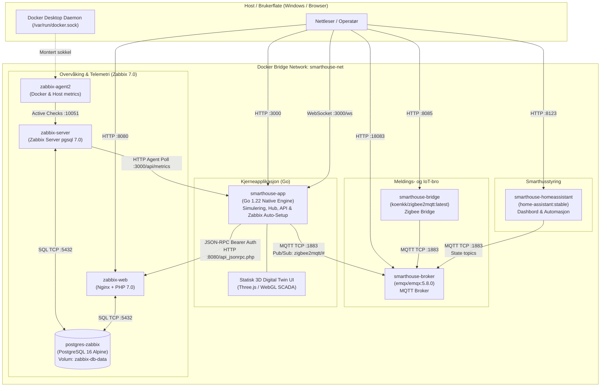
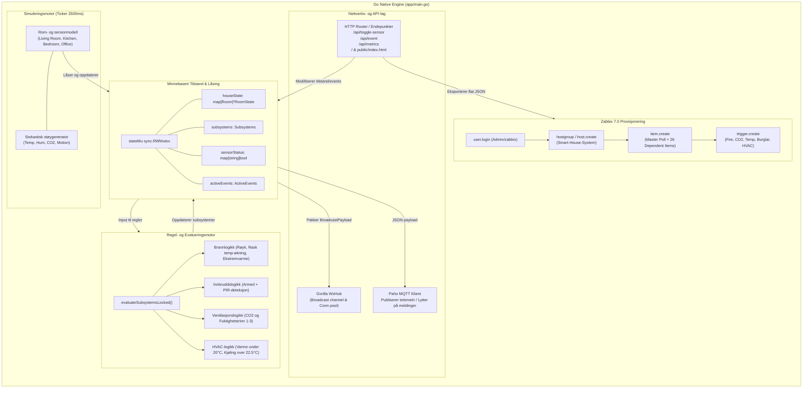
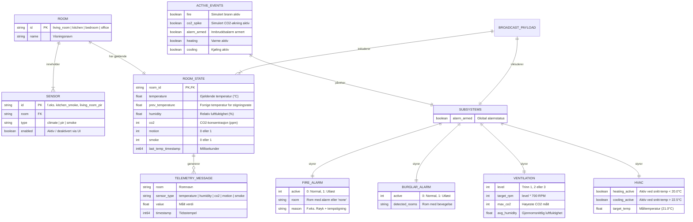
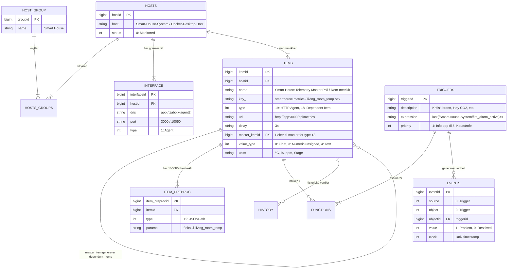
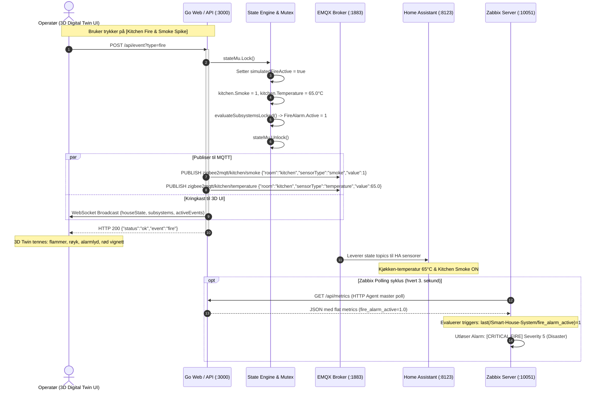
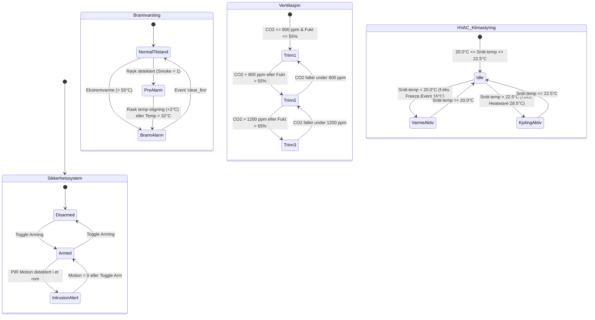
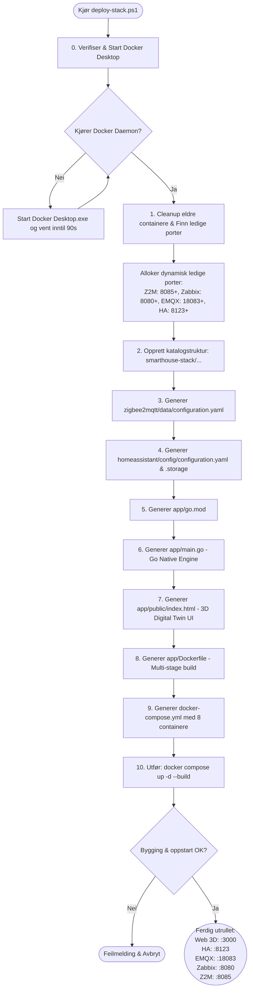

# Smart House Stack - Go Backend, MQTT & 3D Digital Twin


En helhetlig, distribuert IoT-, SCADA- og Digital Twin-plattform implementert med **EMQX MQTT Broker**, **Home Assistant**, **Zigbee2MQTT**, **Zabbix 7.0 Enterprise Monitoring**, en **kompilert Go Native Engine** og et **Three.js 3D SCADA-grensesnitt**.

Alt provisjoneres og orkestreres automatisk som Infrastructure-as-Code (IaC) via PowerShell-skriptet `deploy-stack.ps1`.

---

## Innhold

1. [Oversikt & Utbrettet Struktur](#oversikt--utbrettet-struktur)
2. [System- og Containerarkitektur](#1-system--og-containerarkitektur)
3. [Go Native Engine Intern Arkitektur](#2-go-native-engine-intern-arkitektur)
4. [ER-diagram: Domene- og Tilstandsmodell](#3-er-diagram-domene--og-tilstandsmodell)
5. [ER-diagram: Zabbix 7.0 & PostgreSQL Relasjonsmodell](#4-er-diagram-zabbix-70--postgresql-relasjonsmodell)
6. [Sekvensdiagram: Telemetriflyt og Hendelsesinjeksjon](#5-sekvensdiagram-telemetriflyt-og-hendelsesinjeksjon)
7. [Tilstandsdiagram for Hoveddelsystemer](#6-tilstandsdiagram-for-hoveddelsystemer)
8. [Deployment- og Utførelsesflyt](#7-deployment--og-utførelsesflyt)
9. [Porter og Nettverk](#8-porter-og-nettverk)
10. [REST API & MQTT-struktur](#9-rest-api--mqtt-struktur)
11. [Kjøreinstruksjoner](#10-kjøreinstruksjoner)

---

## Oversikt & Utbrettet Struktur

Når `deploy-stack.ps1` kjøres, genereres en komplett mikrotjenestearkitektur i mappen `smarthouse-stack/`:

```
smarthouse-stack/
├── docker-compose.yml              # 8 samvirkende mikrotjenester på smarthouse-net
├── zigbee2mqtt/
│   └── data/
│       └── configuration.yaml      # Z2M broker-oppsett og discovery
├── homeassistant/
│   └── config/
│       ├── configuration.yaml      # MQTT sensorer for alle 4 rom
│       └── .storage/
│           └── core.config_entries # Forhåndskonfigurert EMQX MQTT-tilkobling
└── app/
    ├── go.mod                      # Go 1.22 modulavhengigheter (Paho MQTT, Gorilla WS)
    ├── main.go                     # Go Native Engine (Simulering, Hub, Zabbix Auto-Setup)
    ├── Dockerfile                  # Multi-stage build for ultra-kompakt Linux-binær
    └── public/
        └── index.html              # Three.js 3D Digital Twin SCADA UI
```

---

## 1. System- og Containerarkitektur

Diagrammet viser alle 8 containere på det felles Docker-nettverket `smarthouse-net`, eksponerte host-porter og kommunikasjonsprotokoller.



---

## 2. Go Native Engine Intern Arkitektur

Go-applikasjonen (`app/main.go`) fungerer som det sentrale nervesystemet for sanntidssimulering, telemetri, delsystemevaluering og overvåking.



---

## 3. ER-diagram: Domene- og Tilstandsmodell

Domenemodellen definerer rom, sensorer, telemetri, subsystemer og hendelser:



---

## 4. ER-diagram: Zabbix 7.0 & PostgreSQL Relasjonsmodell

Modellen viser hvordan Zabbix auto-provisjoneringen oppretter og strukturerer overvåkingen i PostgreSQL (`zabbix-db`):



---

## 5. Sekvensdiagram: Telemetriflyt og Hendelsesinjeksjon

Eksempel på sanntids hendelsesflyt når en operatør utløser en brannsimulering fra 3D-grensesnittet:



---

## 6. Tilstandsdiagram for Hoveddelsystemer



---

## 7. Deployment- og Utførelsesflyt



---

## 8. Porter og Nettverk

| Tjeneste | Container | Standard Port | Protokoll | Beskrivelse |
| :--- | :--- | :--- | :--- | :--- |
| **3D Digital Twin / Go App** | `smarthouse-app` | `3000` | HTTP / WS | Three.js SCADA UI, REST API og Zabbix telemetri |
| **Home Assistant** | `smarthouse-homeassistant` | `8123` | HTTP | Smarthus-dashbord med forhåndsdefinerte sensorer |
| **EMQX Broker** | `smarthouse-broker` | `1883`, `18083` | TCP / HTTP | MQTT-megler og EMQX Web Dashboard (`admin`/`public`) |
| **Zabbix Web UI** | `zabbix-web` | `8080` | HTTP | Overvåkingsportal og JSON-RPC API (`Admin`/`zabbix`) |
| **Zabbix Server** | `zabbix-server` | `10051` | TCP | Zabbix kjerne med PostgreSQL backend |
| **Zigbee2MQTT** | `smarthouse-bridge` | `8085` | HTTP | Frontend for Zigbee bridge og enheter |
| **PostgreSQL** | `zabbix-db` | *Intern 5432* | SQL | Persistent database for Zabbix (`zabbix-db-data`) |
| **Zabbix Agent 2** | `zabbix-agent2` | *Intern 10050* | TCP | Docker-socket og containerovervåking |

---

## 9. REST API & MQTT-struktur

### REST Endepunkter (`smarthouse-app:3000`)
- `GET /api/metrics`: Returnerer flat JSON-struktur for Zabbix HTTP Agent master polling.
- `POST /api/event?type={fire|clear_fire|co2_spike|freeze|heatwave|toggle_arm}`: Injiserer hendelser og tester delsystemrespons i sanntid.
- `POST /api/toggle-sensor?id={sensor_id}`: Skrur virtuelle sensorer av/på (f.eks. `kitchen_smoke`, `living_room_pir`).
- `GET /ws`: WebSocket-endepunkt for full sanntidssynkronisering mot 3D-tvillingen.

### MQTT Emne-hierarki (`zigbee2mqtt/`)
- `zigbee2mqtt/<room>/temperature`
- `zigbee2mqtt/<room>/humidity`
- `zigbee2mqtt/<room>/co2`
- `zigbee2mqtt/<room>/motion`
- `zigbee2mqtt/kitchen/smoke`

---

## 10. Kjøreinstruksjoner

1. Åpne en PowerShell-terminal som administrator eller vanlig bruker.
2. Naviger til mappen:
   ```powershell
   cd C:\dev\mqttStack-goBackend-main
   ```
3. Start distribusjonen:
   ```powershell
   powershell -ExecutionPolicy Bypass -File .\deploy-stack.ps1
   ```
4. Åpne nettleseren på `http://localhost:3000` for 3D Digital Twin, eller portene angitt i terminalen ved fullført utrulling.
